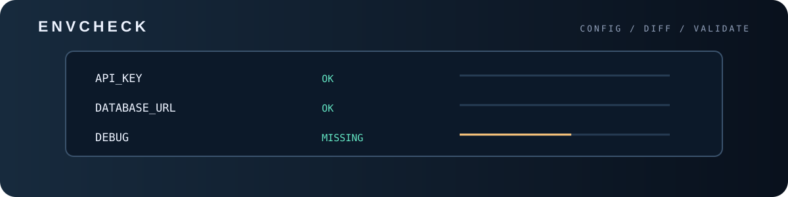
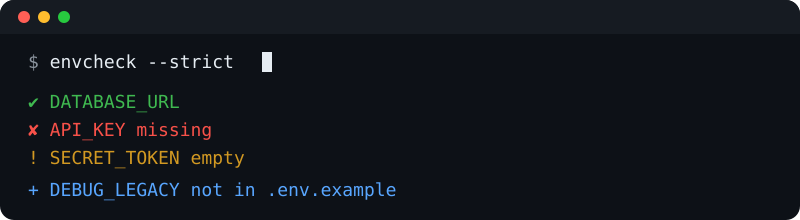

<p align="center">

<p align="center"></p>
  
</p>

<h1 align="center">envcheck</h1>

<p align="center">
  Compare your <code>.env</code> against <code>.env.example</code> in one command.<br>
  Zero dependencies. Python 3.8+.
</p>

---

## Why?

"Works on my machine" often means a teammate forgot a variable. `envcheck` tells you
instantly which keys are **missing**, **empty**, **duplicated** or **not documented**
in your example file, and can fix the missing ones for you.

## Install

```bash
git clone https://github.com/ERROR404DTIR/envcheck.git
cd envcheck
pip install .          # optional: gives you the `envcheck` command
# or just run: python envcheck.py
```

## Usage

```bash
envcheck                              # compare .env with .env.example
envcheck --env .env.prod --example .env.example
envcheck --strict                     # empty/extra keys also fail
envcheck --fix                        # append missing keys to .env
envcheck --json                       # machine-readable output
```

### Example output

```text
✘ Missing from env file (1)
    API_KEY
! Empty values (1)
    SECRET_TOKEN
+ Not in example file (1)
    DEBUG_LEGACY
```

### Exit codes

| Code | Meaning                                                              |
|------|----------------------------------------------------------------------|
| 0    | Everything matches                                                   |
| 1    | Missing keys, duplicates or invalid lines (or any warning in `--strict`) |
| 2    | A file was not found                                                 |

## Use in CI

```yaml
- name: Check env file
  run: python envcheck.py --env .env.ci --strict
```

## Tests

```bash
python -m unittest discover -s tests
```

## License

MIT